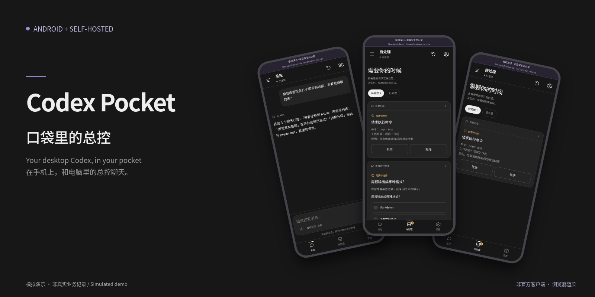
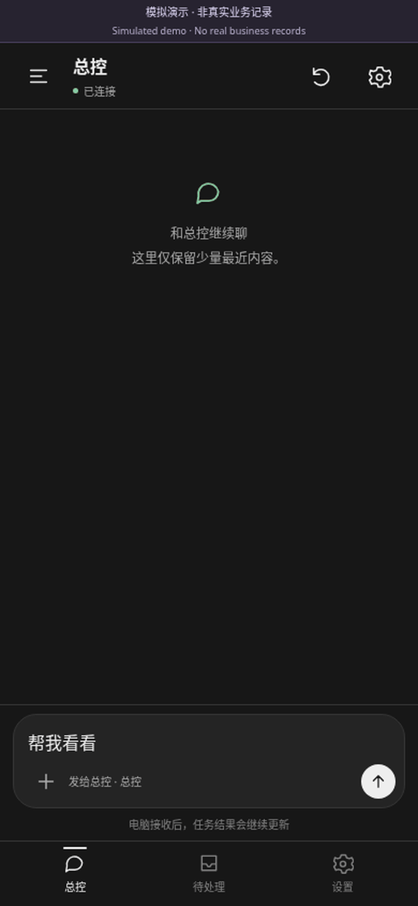
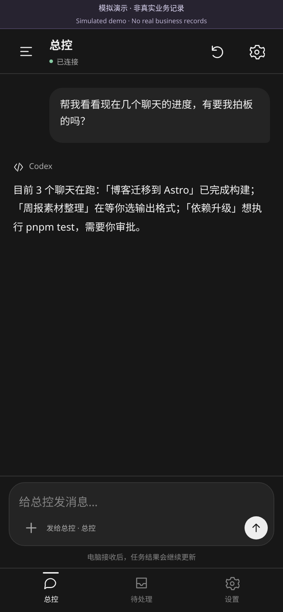
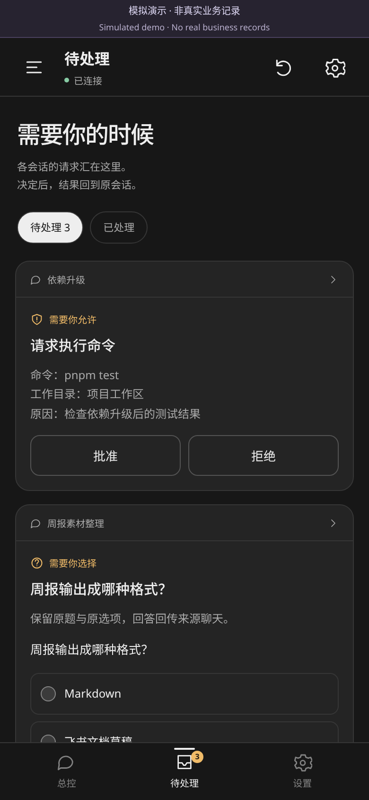
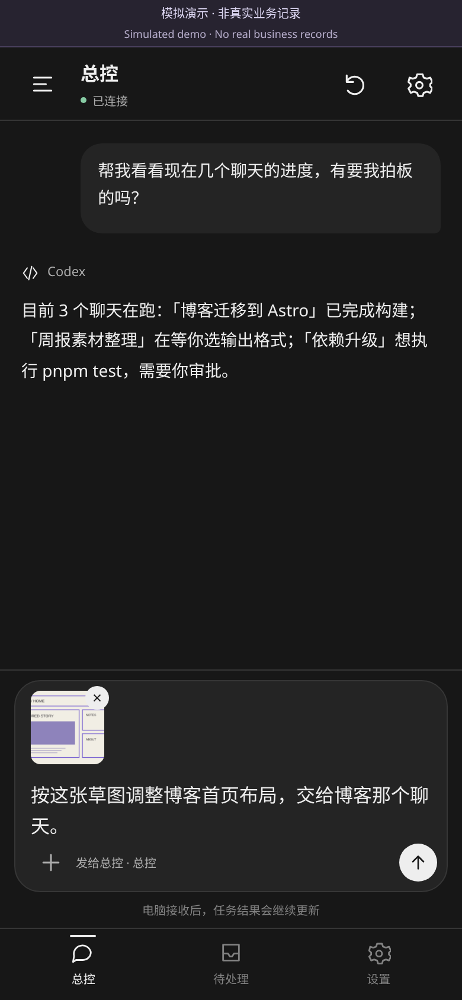
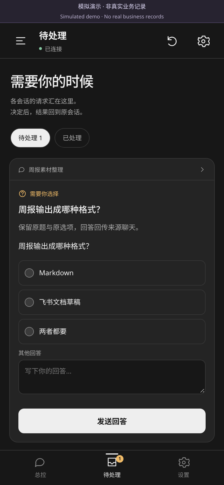
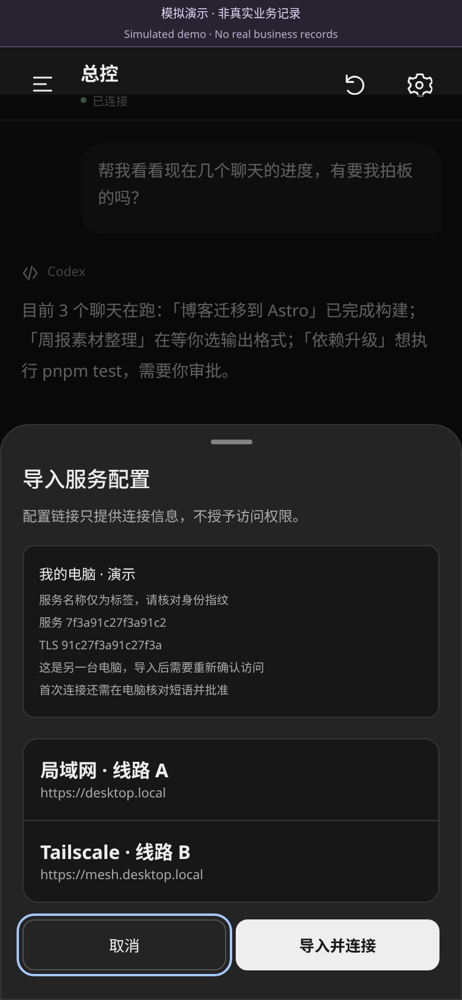
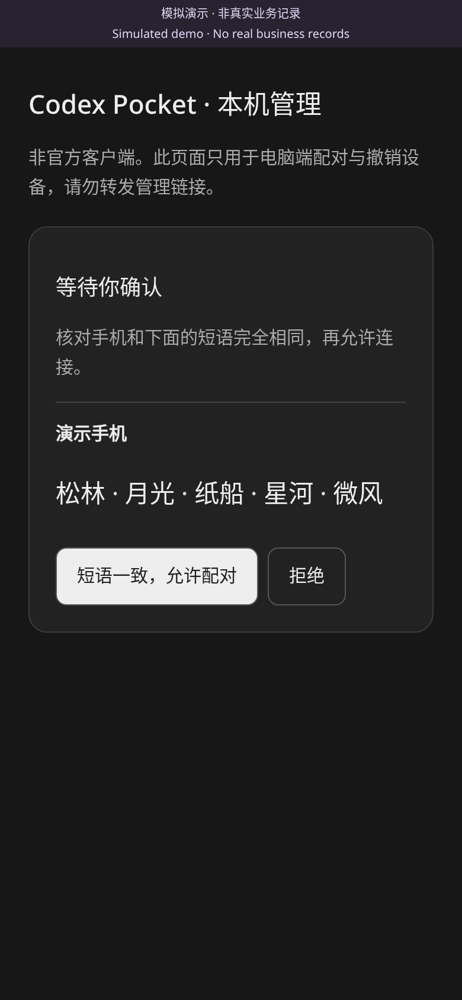
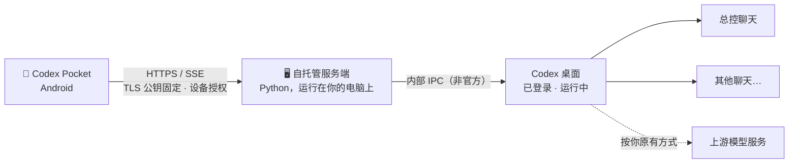

<div align="center">



# Codex Pocket

**口袋里的总控 —— 在手机上，和你电脑里的 Codex 总控聊天。**

非官方 Android App + 自托管服务端 · 接入你正在运行的 Linux Codex 桌面
<br>不是远程桌面 · 不另起模型执行器 · 不需要另配一套模型 API Key

   [](LICENSE)

[快速开始](#快速开始) · [安全设计](#安全设计) · [当前边界](#当前边界) · [English](#english)

</div>

---

## 为什么做它

电脑上的 Codex 往往同时跑着好几个聊天：一个在重构，一个在整理资料，一个在等你批准命令。
你一离开工位，它们就停下来等你。

Codex Pocket 让你在手机上与一个**总控聊天**对话，由它在原来的桌面环境里照看其他聊天。
执行始终发生在你的电脑上，沿用你已有的会话和审批策略。手机只是把你"带回"那张桌子。

<div align="center">

<br><sub>⚠️ 模拟演示，非真实业务记录</sub>
</div>

## 核心场景

| 💬 问总控 | ✅ 随手审批 | 📷 发图下指令 |
|:---:|:---:|:---:|
|  |  |  |
| "现在几个聊天进度如何？"<br>总控在原桌面里查看后回答 | 命令审批沿用原 request ID<br>文件修改、MCP 等回电脑处理 | 把白板草图附给总控<br>由它决定交给哪个聊天 |

<details>
<summary>更多画面：原生异步问题 · 配对预览 · 电脑端核对</summary>
<br>
<p align="center">


</p>
<p align="center"></p>
</details>

<sub>截图由浏览器渲染 App 内置的 Web 界面（390×844 @2x），数据为隔离的演示数据。截图用于展示界面，不代表原生功能实测。</sub>

**想直接看看？** 仓库附带一份独立的静态演示，使用模拟桥，不连接任何真实服务：

```bash
cd docs/demo && python3 -m http.server 8080   # 然后在浏览器打开 http://localhost:8080
```

## 工作原理



- **轻量同步**：总控只缓存最近 30 条消息，其他历史按需读取，缩略图也按需加载。
- **原样转达**：原生异步问题保留原题和原选项，命令审批沿用原 request ID。
- **不替你做决定**：服务端不会自己创建会话或派发任务。
- **不打断桌面**：目标聊天忙碌时，图片和异步回答会被拒绝，草稿保留在手机上等你稍后再发。服务端不会替你排队，也不会自动送达。
- **不盲目重发**：投递结果未知的消息不会自动重发，避免同一条指令被执行两次。

## 快速开始

**前提**

- 一台 Linux 电脑，Codex 桌面**已登录并保持运行**，并且你有自己的 Codex 使用权限
- 一部 Android 手机，能通过局域网或 Tailscale 访问这台电脑
- Python 3.11 或更高版本

### 1. 启动服务端

```bash
git clone https://github.com/Throokie/codex-pocket.git
cd codex-pocket
python3 -m venv .venv
.venv/bin/python -m pip install -r requirements.txt

.venv/bin/python -m server \
  --data "$HOME/.local/share/codex-pocket" \
  --controller YOUR_CONTROLLER_THREAD_ID \
  --caller-thread YOUR_CONTROLLER_THREAD_ID \
  --media-root "$HOME/Pictures"
```

- `YOUR_CONTROLLER_THREAD_ID`：替换为你在 Codex 桌面中**已经存在**的、准备用作总控的聊天 ID。两个参数填同一个 ID。服务端不会替你新建聊天。
- `--media-root`：只填写你**明确愿意向手机开放**的图片目录。示例中的 `~/Pictures` 仅供参考，可以换成更窄的专用目录。
- 请先启动 Codex 桌面，再启动服务端。

### 2. 打开管理页（仅限本机访问）

在另一个终端运行：

```bash
POCKET_DATA="$HOME/.local/share/codex-pocket" .venv/bin/python scripts/open-manager.py
```

### 3. 安装 App

从 [Releases](https://github.com/Throokie/codex-pocket/releases) 下载 `CodexPocket-0.4.0.apk`，并核对 Release 页面给出的 SHA-256。

> 这是**开发签名**的预览包，可以直接覆盖安装本项目此前用同一签名发布的版本。
> 如果你用自己的 key 编译，签名不同，就不能直接覆盖安装。请务必备份并妥善保管你的 key。
> 不建议为了升级而卸载 App 或清除数据，那样会丢失配对和草稿。

### 4. 配对（只需一次）

1. 用手机扫描管理页上的配置二维码
2. 手机在**本地**预览服务身份指纹和候选线路
3. 点「导入并连接」
4. 回到电脑，核对两边的短语一致后点批准

以后从同一台电脑重新导入，只会更新线路，原有的配对和草稿都会保留。

## 网络与线路

- 电脑自动发现局域网和 Tailscale 地址，地址变化会同步到手机
- 手机按实际探测耗时选择线路，并设有切换稳定门槛，避免来回跳动
- 可以手动固定某条线路，也可以排除仅供电脑使用的网卡
- 可选开启前台可见的后台连接

> Codex Pocket **不会**修改你的防火墙或 ACL，也**不会**安装 VPN。手机和电脑之间的网络必须本来就能互通。

## 安全设计

| 机制 | 说明 |
|---|---|
| 链接 ≠ 授权 | 配置链接不含长期设备 token，可以随时轮换；首次连接必须在电脑上核对短语并批准 |
| 独立设备授权 | 每台手机单独授权，可以单独撤销 |
| 凭据存储 | 设备 token 用 Android Keystore 中的密钥加密后，存放在 App 私有目录 |
| 传输 | 固定 TLS 公钥指纹（同一密钥续期证书不影响连接），配合签名的地址列表 |
| 管理页 | 只允许电脑本机访问 |
| 前端 | 内置本地 Web 界面，使用原生 HTTP/SSE，首屏不加载任何远程网页 |
| 回电脑处理 | 文件修改、MCP 调用、额外权限申请，以及无法在手机上完整展示的审批，一律提示你回电脑处理 |

漏洞报告方式见 [SECURITY.md](SECURITY.md)。

## 给自动化与 Agent：ADB 文件入口

可以把配对预览或图片草稿直接导入 App，Agent 不需要操作 UI：

```bash
python3 scripts/pocket-adb.py --serial YOUR_DEVICE_SERIAL init
python3 scripts/pocket-adb.py --serial YOUR_DEVICE_SERIAL import-image ./sketch.png
python3 scripts/pocket-adb.py --serial YOUR_DEVICE_SERIAL status
```

该入口只会把内容导入为预览或草稿，**不会自动发送、不会自动审批，也不会导出凭据**。
目录结构和 `adb push` 用法见 [docs/ADB_FILES.md](docs/ADB_FILES.md)。

## 更多文档

[自托管与构建](docs/SELF_HOST.md) · [配置导入](docs/CONFIG_IMPORT.md) · [自动发现](docs/AUTO_DISCOVERY.md) · [网络与线路](docs/NETWORKS.md) · [协议](protocol/API.md) · [验证范围](docs/VALIDATION.md)

## 当前边界

使用前请读完这一节。

- **平台**：目前仅支持 Android 和 Linux Codex 桌面。
- **非官方协议**：依赖 Codex 桌面的内部 IPC，官方不保证其稳定，桌面更新后可能失效。
- **桌面必须在线**：电脑需要保持运行和登录，使用的是你自己的 Codex 使用权限。
- **推送**：不保证锁屏、Doze 或系统强杀进程之后仍能收到推送。
- **网络**：不承诺零配置，也不保证所有已知地址都失联后还能恢复连接。
- **发行形态**：开发预览 APK，不是应用商店的正式包。

## 验证情况

以下测试均在本地完成。仓库已包含 CI 配置（只读权限，不含正式签名），但尚未在远端执行。

| 范围 | 内容 |
|---|---|
| 自动化测试 | Python 95 项、Java 165 项，另含 10000 事件合并测试（本地运行；已配置 CI，尚未在远端执行） |
| 模拟器 | 最终 APK 在 API 33 AVD 上跑通 15 个导入、取消、迁移场景 |
| 真机（0.4.0） | 一台 Android 16 设备覆盖安装后配对保留；关闭 Wi-Fi 后经蜂窝网络 + Tailscale 成功读取总控和聊天状态 |
| 真机（早期版本） | 曾观察到桌面消息更新同步到手机；曾验证从手机发送的图片能被桌面聊天识别。0.4.0 尚未在同一条件下重测 |
| 命令审批 | 已有接口实现和替身（mock）测试；**尚未**用真实触发的原生命令审批做端到端验收 |
| 尚未验证 | 模型新生成的图片自动回传到手机；相机光学扫码；所有已知地址同时失联时的重新发现；Doze 下的行为 |

以上结果不构成通用的延迟指标，也不代表所有设备都已完整通过。

## FAQ

**和远程桌面有什么区别？**
Codex Pocket 不传输屏幕画面，只传输结构化的消息、审批和问题，更适合手机小屏操作。

**我的数据会经过哪里？**
App 只和运行在你电脑上的自托管服务端通信，不经过本项目的任何服务器。Codex 桌面本身仍然按你原有的方式访问上游模型服务，这一部分与使用 Codex Pocket 之前没有变化。

**"不需要 API Key"是什么意思？**
App 不需要你另外配置一套模型 API。模型调用仍由你电脑上的 Codex 桌面完成。

**它会自己在后台干活吗？**
不会。服务端不会自动创建会话或派发任务。

## 许可

本项目以 [MIT](LICENSE) 许可发布，© Throokie。第三方组件保留各自的许可，见 [THIRD_PARTY_NOTICES.md](THIRD_PARTY_NOTICES.md)。
本项目不包含 Codex 源码，与 OpenAI 没有关联。

---

## English

**Codex Pocket** is an unofficial Android app with a self-hosted Python server. It lets you chat from your phone with a "controller" conversation inside your running Linux Codex desktop, and that controller looks after your other chats. Your existing sessions and approval policies stay in place. It is not a remote desktop, it does not add a separate model runner, and it requires no extra model API key. Model access still goes through your desktop Codex as before.

Highlights: an inbox for command approvals (original request IDs) and native questions (original wording and options), one-time pairing confirmed on the desktop, per-device revocable authorization, tokens encrypted with an Android Keystore key, pinned TLS public key, and LAN/Tailscale route selection.

**Status:** development preview. Android + Linux only. Relies on undocumented desktop IPC. See the Chinese sections above for setup commands and limitations.
